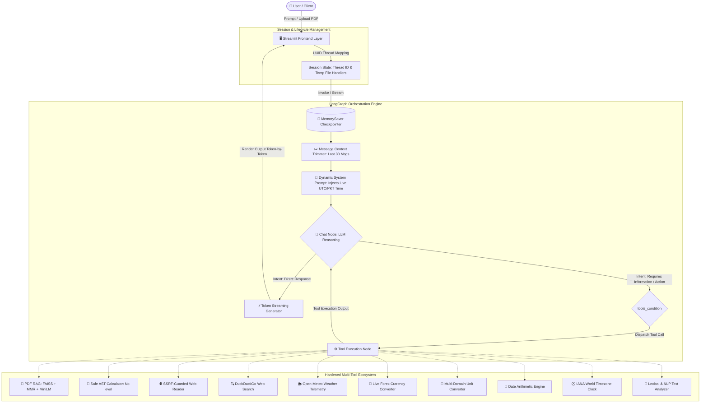

# 🤖 RAGentic: Enterprise-Grade Autonomous Agentic RAG System

[](https://www.python.org/)
[](https://langchain-ai.github.io/langgraph/)
[](https://www.langchain.com/)
[](https://streamlit.io/)
[](https://github.com/facebookresearch/faiss)
[](https://huggingface.co/sentence-transformers/all-MiniLM-L6-v2)
[](https://opensource.org/licenses/MIT)

> **RAGentic** is an enterprise-grade, security-hardened **Autonomous Agentic RAG (Retrieval-Augmented Generation)** conversational platform. Built on **LangGraph cyclic state machines**, **LangChain**, and **Streamlit**, it dynamically routes user intent between PDF vector embeddings, real-time web browsing, an AST-verified safe mathematical engine, live financial and weather telemetry, and contextual conversation memory.

---

## 📌 Executive Summary & Portfolio Overview

Modern Large Language Models (LLMs) face four fundamental engineering hurdles in enterprise production: **knowledge cutoffs**, **factual hallucinations**, **inability to perform deterministic calculations**, and **security vulnerabilities from unbounded tool execution**. 

**RAGentic** addresses these limitations by pairing **stateful agentic workflows** with **deterministic retrieval and verification primitives**:

* **Cyclic Agentic Execution (`LangGraph`)**: Moves beyond brittle, sequential linear chains. If a tool fails or provides incomplete data, the agent autonomously reflects, recalibrates its parameters, and retries.
* **Thread-Isolated Multi-Tenant RAG**: Completely eliminates state leakage between concurrent sessions using thread-safe, mutex-guarded session vector stores and LangGraph memory checkpoints.
* **Defense-in-Depth Security**: Eliminates Remote Code Execution (RCE) via an AST (Abstract Syntax Tree) math evaluator and mitigates Server-Side Request Forgery (SSRF) with DNS resolution validation and hop-by-hop redirect inspections.
* **Hybrid Multi-LLM Orchestration**: Automated zero-downtime failover between **OpenAI (`gpt-4o-mini`)** and **Groq (`llama-3.3-70b-versatile`)**, featuring transient tool-call error recovery.

---

## 🎯 The Problems Solved

| Traditional LLM / Naive RAG Failure Mode | The Real-World Engineering Problem | How RAGentic Solves It |
| :--- | :--- | :--- |
| **Factual Hallucinations in Documents** | Naive top-$k$ vector retrieval frequently grabs repetitive chunks, losing semantic diversity and inducing hallucinations when documents lack context. | Implements **Recursive Character Text Splitting (1000/200 overlap)** + **FAISS Vector Indexing** + **Maximal Marginal Relevance (MMR)** ($k=4, \text{fetch\_k}=12$). Enforces strict system-level citation constraints requiring page-level attributions (e.g. `(p. 3)`). |
| **Math & Logic Incompetence** | LLMs are probabilistic autoregressive token predictors, notoriously incapable of reliable multi-step arithmetic, trigonometry, or exponential evaluation. | Engineers a **Custom AST-Based Safe Math Evaluator**. Replaces hazardous `eval()` with strict Python AST node visitor logic with hard caps on recursion, string lengths ($\le 200$), and bit lengths ($\le 10,000$). |
| **State Bleed in Multi-User Deployments** | In multi-user Streamlit apps, naïve vectorstores share global memory pointers, allowing User B to query User A's uploaded sensitive PDFs. | Implements **UUID-Thread Isolated Vector Stores (`_RAG_STORES`)** coupled with `threading.Lock()` mutex primitives. Every session maintains its own vector store bound to its unique LangGraph `thread_id`. |
| **Server-Side Request Forgery (SSRF)** | LLMs equipped with open webpage-fetching tools can be tricked via prompt injection into scanning internal metadata endpoints (`169.254.169.254`, `localhost`). | Builds an **SSRF Firewall (`_is_public_url`)**: resolves hostnames via DNS, validates global routability against private/loopback/link-local IP subnets, verifies hop-by-hop redirects (up to 3 hops), and caps downloads at 1 MB. |
| **Context Window Bloat & Cost Explosion** | Chat histories grow unbounded, triggering context length exhaustion, high token latencies, and escalating API costs. | Deploys LangChain **`trim_messages` Sliding Window Strategy** (`max_tokens=30`). Dynamically prunes oldest conversation turns while strictly anchoring the system prompt and starting human semantics. |
| **Vendor Lock-in & Provider Outages** | Dependency on a single LLM vendor leads to catastrophic service downtime during provider rate-limiting or outages. | Implements an **Adaptive Multi-Provider Gateway**: Auto-detects available API keys, dynamically binding tools to OpenAI GPT-4o-mini or Groq LLaMA 3.3-70B with an automated retry handler for malformed tool calls. |

---

## 🏗️ System Architecture & Workflow

RAGentic is orchestrated as a cyclic directed graph (`StateGraph`) where the LLM functions as a central reasoning agent (ReAct framework) equipped with dynamic tool routing, checkpointer persistence, and message streaming.



---

## 🛠️ Deep Dive: The 10 Autonomous Tools

RAGentic integrates 10 purpose-built tools bound natively to the model via function-calling schemas:

```
┌─────────────────────────────────────────────────────────────────────────────────────────────┐
│                                   RAGentic TOOL MATRIX                                      │
├──────────────────────┬──────────────────────────────┬───────────────────────────────────────┤
│ Tool Category        │ Engineering Implementation    │ Safety & Architecture Controls        │
├──────────────────────┼──────────────────────────────┼───────────────────────────────────────┤
│ 📄 PDF RAG           │ FAISS + all-MiniLM-L6-v2      │ MMR reranking, page-level citation    │
│ 🧮 Math Engine       │ Abstract Syntax Tree (AST)   │ Zero eval(), bit-length & size bounds │
│ 🌐 Webpage Reader    │ Requests + BeautifulSoup4    │ SSRF IP verification, 1MB payload cap │
│ 🔍 Live Web Search   │ DuckDuckGo Search API        │ Real-time query filtering, wt-wt zone │
│ 🌦️ Live Weather      │ Open-Meteo REST API          │ 3-day forecast, WMO code mapping      │
│ 💱 Currency Engine   │ Open Exchange Rates API      │ ISO-4217 validation, live FX rates    │
│ 📏 Unit Converter    │ Dimension Matrix Math        │ Length, mass, vol, temp, digital byte │
│ 📅 Date Calculator   │ Datetime / Timedelta Engine  │ Absolute/relative calendar arithmetic │
│ 🕐 World Clock       │ ZoneInfo (IANA standard)     │ Timezone validation, strftime formats │
│ 📝 NLP Text Analyzer │ Regex & Lexical Frequency    │ Stopword filtering, WPM read metrics  │
└──────────────────────┴──────────────────────────────┴───────────────────────────────────────┤
```

### 1. 📄 Document RAG Engine (`rag_tool`)
* **Vector Store**: FAISS (Facebook AI Similarity Search) in-memory vector database.
* **Embeddings**: `sentence-transformers/all-MiniLM-L6-v2` loaded lazily via a thread-safe singleton pattern (`threading.Lock()`), ensuring instant sub-second app launch times.
* **Retrieval Strategy**: **MMR (Maximal Marginal Relevance)** (`k=4, fetch_k=12`), which optimizes for novelty and suppresses redundant document chunks.
* **Page-Accurate Grounding**: Extracts chunk-level PDF metadata, injecting exact page citations (`p. X`) directly into the LLM context.

### 2. 🧮 AST-Based Safe Calculator (`calculator`)
* **Zero-RCE Design**: Strictly avoids Python's dangerous `eval()` or `exec()`.
* **Grammar Verification**: Parses expressions using Python's `ast.parse(mode="eval")` and evaluates only authorized nodes: `ast.BinOp`, `ast.UnaryOp`, `ast.Constant`, and `ast.Call`.
* **Guardrails**:
  * Caps input expression string length at 200 characters.
  * Guards against algorithmic complexity / denial of service: limits exponent size (`abs(exp) <= 1000`) and integer bit-length (`<= 10,000 bits`).
  * Supports constants ($\pi, e$) and safe math functions (`sqrt`, `log`, `log10`, `exp`, `sin`, `cos`, `tan`, `floor`, `ceil`, `abs`, `round`).

### 3. 🌐 SSRF-Guarded Webpage Reader (`read_webpage`)
* **Anti-SSRF Protection**: Resolves target hostnames against DNS and verifies that all returned IPs are globally routable (`ipaddress.ip_address.is_global`). Blocks private ranges (`10.0.0.0/8`, `172.16.0.0/12`, `192.168.0.0/16`, `127.0.0.1`, `169.254.169.254`).
* **Hop-by-Hop Redirect Inspection**: Follows up to 3 redirects, validating the destination IP at every individual hop before initiating socket transfers.
* **Payload Sanitation**: Enforces a strict 1 MB download cap, checks for `text/html` headers, and strips noise elements (`script`, `style`, `nav`, `footer`, `header`, `aside`, `form`) via BeautifulSoup.

### 4. 🔍 Live Web Search (`search_tool`)
* Direct integration with DuckDuckGo Search API (`ddgs`) with relevance filtering to fetch live real-time knowledge beyond LLM training cutoff dates.

### 5. 🌦️ Global Weather Telemetry (`get_weather`)
* Integrates Open-Meteo APIs (zero API key dependency).
* Two-stage resolution: Geocoding coordinates lookup followed by meteorological forecast retrieval (temperature, apparent temperature, relative humidity, wind speed, precipitation, and 3-day daily forecasts).
* Parses official World Meteorological Organization (WMO) weather interpretation codes into human-readable descriptions.

### 6. 💱 Real-Time Currency Converter (`convert_currency`)
* Pulls live institutional FX exchange rates from `open.er-api.com`.
* Validates currency inputs against standard 3-letter ISO-4217 currency specifications (USD, PKR, EUR, GBP, AED, etc.).

### 7. 📏 Multi-Domain Unit Converter (`convert_units`)
* Handles cross-domain conversions across:
  * **Length**: mm, cm, m, km, in, ft, yd, mi
  * **Mass**: mg, g, kg, lb, oz
  * **Volume**: ml, l, tsp, tbsp, cup, gal
  * **Time**: s, min, h, day, week
  * **Temperature**: Celsius, Fahrenheit, Kelvin
  * **Digital Data**: Byte, KB, MB, GB, TB, KiB, MiB, GiB, TiB (supports standard and binary prefixes).

### 8. 📅 Date Arithmetic Engine (`date_calculator`)
* Parses relative (`today`, `now`) and absolute (`YYYY-MM-DD`) formats.
* Calculates exact calendar spans between dates (days and fractional weeks) or computes forward/backward temporal projections with weekday resolution.

### 9. 🕐 IANA World Timezone Clock (`get_current_time`)
* Uses Python 3.9+ standard `zoneinfo.ZoneInfo` for accurate daylight-saving and regional time calculations across any IANA timezone identifier (e.g., `Asia/Karachi`, `America/New_York`, `UTC`).

### 10. 📝 Lexical & NLP Text Analyzer (`text_analyzer`)
* Computes real-time document analytics: word count, character count, sentence count, average word length, estimated reading time (standardized at 200 WPM), and top-$k$ keyword extraction with stopword pruning.

---

## ⚡ Engineering Highlights & Technical Decisions

### 1. Why LangGraph over Simple Sequential Chains?
Sequential chains (like standard LangChain `LLMChain` or `AgentExecutor`) enforce rigid execution paths. If a tool returns unexpected output, a linear chain breaks. **LangGraph StateGraph** models the agent as a true cyclic graph:
* The LLM emits a tool call $\rightarrow$ `ToolNode` executes the tool $\rightarrow$ the output loops back into `chat_node`.
* The model can inspect the tool output, decide if more information is required, invoke a second tool, or synthesize the final answer.

### 2. Multi-Tenant Memory Architecture
In typical Streamlit prototypes, developers store state in global module-level variables, which breaks as soon as multiple users access the app:
* **RAGentic** isolates every user via a unique UUID `session_id` acting as both the Streamlit session key and the LangGraph `thread_id`.
* The vector store registry (`_RAG_STORES`) is guarded by a re-entrant `threading.Lock()`, ensuring thread safety during high-concurrency read/write operations.
* History persistence is managed by LangGraph's `MemorySaver`, allowing per-thread checkpointing that can be transitioned to Redis, SQLite, or PostgreSQL without altering graph logic.

### 3. Context Optimization with Sliding-Window Pruning
To prevent unbounded token growth and out-of-context errors, conversation state passes through `trim_messages`:
* Keeps the most recent **30 messages** (`strategy="last"`).
* Anchors message trimming to start on a human turn (`start_on="human"`).
* Dynamically re-injects a fresh `SystemMessage` on every iteration with updated real-time date, time, and active timezone coordinates.

---

## 💼 CV / Resume Bullet Points

If you are showcasing this project on your CV, LinkedIn, or portfolio, here are impactful, metric-driven bullet points you can use:

#### For AI / Machine Learning Engineer Roles:
* *Architected an autonomous agentic RAG platform using **LangGraph**, **LangChain**, and **FAISS**, integrating a 10-tool ReAct framework for dynamic multi-step query decomposition and reasoning.*
* *Engineered an enterprise-grade PDF RAG pipeline combining **Recursive Character Text Splitting**, **all-MiniLM-L6-v2** embeddings, and **Maximal Marginal Relevance (MMR)** retrieval, eliminating document hallucinations with page-level citations.*
* *Designed a zero-downtime multi-provider LLM gateway supporting automated fallback between **OpenAI (GPT-4o-mini)** and **Groq (LLaMA-3.3-70B)** with transient tool-call error recovery.*

#### For Backend / Software Engineer Roles:
* *Implemented a thread-safe multi-tenant memory and vectorstore architecture using UUID-keyed session state and mutex locks (`threading.Lock`), resolving cross-session data leaks in concurrent environments.*
* *Engineered defense-in-depth security guardrails, developing an **AST-based safe math evaluator** eliminating `eval()` RCE vulnerabilities and an **SSRF-mitigated web scraper** with DNS-level private IP filtering.*
* *Optimized LLM token usage and latency by deploying dynamic context window trimming and lazy model loading, reducing cold-start latency to under 1 second.*

---

## 🚀 Getting Started

### Prerequisites
* **Python**: `3.10`, `3.11`, `3.12`, or `3.13`
* **API Keys**: An **OpenAI API Key** or a **Groq API Key** (both supported with automatic provider detection).

---

### Step-by-Step Installation

#### 1. Clone the Repository
```bash
git clone https://github.com/Zainch032/RAGentic.git
cd RAGentic
```

#### 2. Create and Activate Virtual Environment
```bash
# Windows (PowerShell)
python -m venv venv
.\venv\Scripts\Activate.ps1

# Windows (Command Prompt)
python -m venv venv
.\venv\Scripts\activate.bat

# Linux / macOS
python3 -m venv venv
source venv/bin/activate
```

#### 3. Install Dependencies
```bash
pip install --upgrade pip
pip install -r requirements.txt
```

#### 4. Configure Environment Variables
Create a `.env` file in the root directory:
```env
# ── Primary Provider: OpenAI (Either variable name is recognized) ──
OPENAI_API_KEY=your_openai_api_key_here
OPEN_API_KEY=your_openai_api_key_here

# ── Fallback Provider: Groq ──
GROQ_API_KEY=your_groq_api_key_here

# ── Optional Model Configurations ──
OPENAI_MODEL=gpt-4o-mini
GROQ_MODEL=llama-3.3-70b-versatile
DEFAULT_TIMEZONE=Asia/Karachi
```

> [!TIP]
> **Zero Configuration Hassle**: If you only have an OpenAI key, the app runs on OpenAI. If you only have a Groq key, it seamlessly switches to Groq.

#### 5. Launch the Application
```bash
streamlit run frontend.py
```
The application will launch in your browser at: `http://localhost:8501`.

---

## 🧪 Comprehensive Test Scenarios

Try these queries in the chat interface to verify dynamic multi-tool agentic routing:

```
┌──────────────────────────────────────┬────────────────────────────────────────────────────────┐
│ Test Capability                      │ Example Prompt                                         │
├──────────────────────┬───────────────┴────────────────────────────────────────────────────────┤
│ 📄 Grounded Document RAG             │ [Upload PDF in sidebar]                                │
│                                      │ "What are the primary conclusions in section 4? Cite   │
│                                      │ the exact page numbers."                               │
├──────────────────────────────────────┼────────────────────────────────────────────────────────┤
│ 🧮 Safe Mathematical Calculation     │ "Evaluate (1450 * 1.18) / 4 + sqrt(256) - 2**8"        │
├──────────────────────────────────────┼────────────────────────────────────────────────────────┤
│ 🌦️ Live Global Weather & Forecast    │ "What is the current temperature and 3-day forecast    │
│                                      │ for Tokyo?"                                            │
├──────────────────────────────────────┼────────────────────────────────────────────────────────┤
│ 💱 Real-Time Currency Conversion     │ "Convert 2500 USD to PKR using live exchange rates."   │
├──────────────────────────────────────┼────────────────────────────────────────────────────────┤
│ 🌐 SSRF-Safe Webpage Reading         │ "Summarize the key takeaways from https://example.com" │
├──────────────────────────────────────┼────────────────────────────────────────────────────────┤
│ 🔍 Live Web Intelligence             │ "What are the latest updates on Python 3.13 released   │
│                                      │ this month?"                                           │
├──────────────────────────────────────┼────────────────────────────────────────────────────────┤
│ 📅 Calendar Arithmetic               │ "How many days and weeks are there until December      │
│                                      │ 31st, 2026?"                                           │
├──────────────────────────────────────┼────────────────────────────────────────────────────────┤
│ 📏 Multi-Unit Conversion             │ "How many gigabytes (GB) are in 4,500,000 kilobytes?" │
├──────────────────────────────────────┼────────────────────────────────────────────────────────┤
│ 📝 Lexical & Reading Analysis        │ "Analyze this text and give me word count, reading     │
│                                      │ time, and top keywords: [Paste text block]"           │
└──────────────────────────────────────┴────────────────────────────────────────────────────────┘
```

---

## 📁 Repository Structure

```
RAGentic/
├── backend.py            # LangGraph StateGraph, Tool definitions, RAG pipeline & LLM setup
├── frontend.py           # Streamlit UI, token-level streaming, session lifecycle & sidebar
├── requirements.txt      # Production dependencies (LangGraph, FAISS, PyPDF, etc.)
├── .env                  # Environment secrets (API keys, models, default timezone)
├── .gitignore            # Git exclusions (venv, __pycache__, .env, uploaded files)
└── README.md             # Complete project documentation & technical specification
```

---

## 🛡️ Security & Enterprise Readiness Checklist

- [x] **Zero `eval()` / `exec()` Execution**: Math evaluated via isolated AST parser.
- [x] **Full SSRF Protection**: Global IP checks with recursive redirect validation.
- [x] **Payload Truncation**: Network downloads strictly capped at 1 MB.
- [x] **Thread-Safe Vectorstores**: Re-entrant mutex locking across all concurrent sessions.
- [x] **Automated Session Cleanup**: Temporary files purged immediately after indexing.
- [x] **Context Overflow Protection**: Explicit message trimming ensures bounds safety.
- [x] **Automated Model Failover**: Built-in retry loops for JSON tool-call anomalies.

---

## 📜 License & Acknowledgments

This project is open-source and distributed under the **[MIT License](LICENSE)**.

Developed by **[Zain](https://github.com/Zainch032)** — built for portfolio presentation and enterprise AI engineering demonstration.
