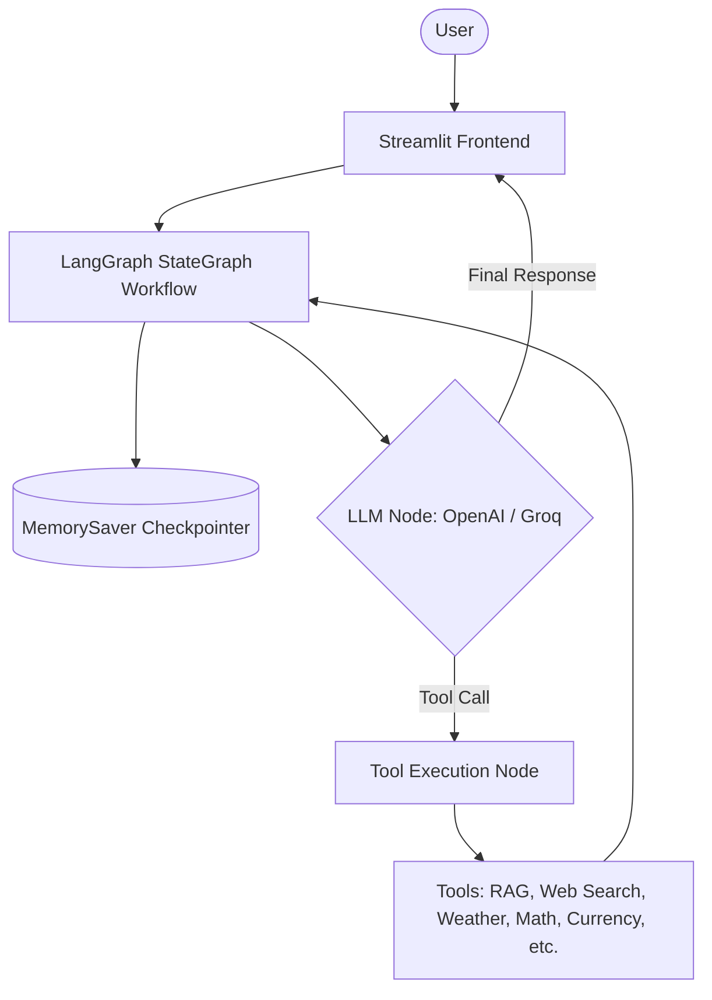

# 🤖 RAG-Powered Multi-Tool AI Chatbot

An enterprise-ready AI chatbot built with **LangGraph**, **LangChain**, and **Streamlit** that supports multi-turn conversation memory, PDF-based Retrieval-Augmented Generation (RAG), live web search, safe code/math execution, and a suite of real-world utility tools.


---

## ✨ Features & Tools

| Feature / Tool | Description |
|----------------|-------------|
| 💬 **Multi-Turn Memory** | Uses LangGraph `MemorySaver` thread checkpointing + context trimming for seamless multi-turn conversations. |
| 📄 **PDF RAG** | Upload any PDF to automatically chunk, embed (`all-MiniLM-L6-v2`), and index into FAISS with MMR retrieval and exact page number citations. |
| 🔍 **Web Search** | Live internet search via DuckDuckGo (`ddgs`) with relevance filtering. |
| 🌐 **Webpage Reader** | Fetches and parses clean text from public web pages with SSRF protection. |
| 🧮 **Safe Calculator** | AST-based safe math expression evaluator supporting trigonometry, logarithms, powers, and constants (`pi`, `e`). No `eval()` security risks. |
| 🌦️ **Live Weather** | Current conditions and 3-day forecast for any global city via Open-Meteo (no API key required). |
| 💱 **Currency Converter** | Live exchange rate conversions for major world currencies (USD, PKR, EUR, GBP, AED, etc.) via open exchange rates API. |
| 📏 **Unit Converter** | Comprehensive conversion across length, mass, volume, time, temperature (°C/°F/K), and digital storage (bytes to TB). |
| 📅 **Date Calculator** | Date arithmetic, calculating days/weeks between dates or shifting dates forward/backward. |
| 🕐 **World Time** | Formatted local time across any IANA timezone (e.g. `Asia/Karachi`, `UTC`, `America/New_York`). |
| 📝 **Text Analyzer** | Text statistics: word count, character count, sentence count, average word length, estimated reading time, and keyword extraction. |
| 🔀 **Dual LLM Support** | Automatic provider detection: uses **OpenAI** (`gpt-4o-mini`) when `OPENAI_API_KEY` or `OPEN_API_KEY` is provided, with seamless fallback to **Groq** (`llama-3.3-70b-versatile`). |

---

## 🏗️ Architecture



---

## 📁 Project Structure

```
Rag_based_app/
├── backend.py          # LangGraph workflow, tool definitions, RAG pipeline, LLM setup
├── frontend.py         # Streamlit UI with streaming responses & sidebar controls
├── requirements.txt    # Project dependencies
├── .env                # API keys configuration (OpenAI / Groq)
├── .gitignore          # Git ignore rules
└── README.md           # Documentation
```

---

## 🚀 Getting Started

### Prerequisites

- **Python 3.10+** (Python 3.11, 3.12, and 3.13 supported)
- An **OpenAI API key** or a **Groq API key**

### 1. Clone the Repository

```bash
git clone <your-repo-url>
cd Rag_based_app
```

### 2. Set Up Virtual Environment

```bash
# Create virtual environment
python -m venv venv

# Activate on Windows (PowerShell):
.\venv\Scripts\Activate.ps1

# Activate on Windows (Command Prompt):
.\venv\Scripts\activate.bat

# Activate on macOS / Linux:
source venv/bin/activate
```

### 3. Install Dependencies

```bash
pip install -r requirements.txt
```

### 4. Configure Environment Variables

Create or update the `.env` file in the project root:

```env
# Primary LLM: OpenAI (both OPENAI_API_KEY and OPEN_API_KEY are supported)
OPENAI_API_KEY=sk-proj-your-key-here
OPEN_API_KEY=sk-proj-your-key-here

# Fallback LLM: Groq
GROQ_API_KEY=gsk_your-groq-key-here

# Optional: customize models or default timezone
OPENAI_MODEL=gpt-4o-mini
GROQ_MODEL=llama-3.3-70b-versatile
DEFAULT_TIMEZONE=Asia/Karachi
```

> [!NOTE]
> The app detects `OPENAI_API_KEY` (or `OPEN_API_KEY`) and defaults to OpenAI. If neither is available, it automatically switches to Groq using `GROQ_API_KEY`.

### 5. Launch the Application

```bash
streamlit run frontend.py
```

The Streamlit web interface will automatically open in your browser at:
`http://localhost:8501`

---

## 💡 Example Prompts to Try

- **PDF RAG**: Upload any PDF in the sidebar, then ask: *"What are the key findings mentioned in section 3?"* (Answers include page references).
- **Weather**: *"What is the weather like in Lahore right now?"*
- **Currency**: *"Convert 150 USD to PKR"*
- **Units**: *"How many miles is 42 kilometers?"*
- **Math**: *"Calculate (1450 * 1.18) / 4 + sqrt(256)"*
- **Web Search**: *"What were the latest announcements from Google DeepMind this week?"*
- **Date Math**: *"How many days until December 31st?"*

---

## 📄 License

This project is open-source under the [MIT License](LICENSE).
